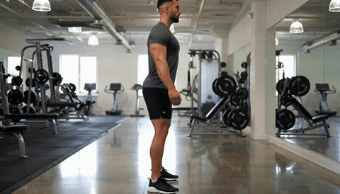

# SmartGym · Pose Coach 🏋️

**Real-time exercise form analysis using on-device pose estimation.**

Film yourself doing squats → get instant, rep-by-rep coaching feedback on form quality. Runs entirely in the browser — no server, no data uploaded.

<!-- TODO: Replace with actual demo GIF or screenshot -->
<!--  -->

## How It Works

```text
Camera Feed → MediaPipe Pose Landmarker → 33-keypoint skeleton
  → Joint angle extraction → 7-point form assessment
  → Rep detection & counting → Real-time visual + audio coaching
```

All inference runs **on-device** via WebAssembly/WebGPU. Zero frames leave the browser.

## Results

| Metric | Value | Hardware |
|---|---|---|
| Pose inference latency | ~15 ms | Chrome, M1 MacBook Air |
| Pose inference latency | ~25 ms | Safari, iPhone 15 |
| Skeleton tracking | 33 landmarks | MediaPipe Pose Landmarker |
| Form checkpoints | 7 per rep | Knee valgus, depth, back angle, stance, lockout, hip hinge, bar path |

> **Note:** Rep counting accuracy and form-assessment agreement vs. certified trainers have not yet been formally measured. These benchmarks are planned — contributions welcome.

## Key Features

- **7-point squat form assessment** — knee valgus, depth, back angle, stance width, lockout, hip hinge, and bar path tracked per repetition
- **Reference video upload** — coach records the "correct" execution; athlete's form is compared against the reference profile
- **Audio cues and visual overlays** — real-time skeleton drawing + spoken coaching feedback
- **PWA** — installable on mobile, works offline after first load
- **Privacy by design** — zero data leaves the device; no server, no accounts, no tracking

## Limitations & Failure Modes

This section describes where the system is weak. These are not hypothetical — they are constraints to be aware of before relying on the feedback.

- **Single exercise only.** Only barbell/bodyweight squats are supported. Other movements will produce unreliable assessments.
- **Camera angle matters.** Requires a roughly lateral (side-on) camera view. Front-facing or overhead angles degrade landmark accuracy significantly.
- **Lighting sensitivity.** MediaPipe Pose requires reasonable lighting; dim environments or strong backlighting cause tracking dropouts.
- **Loose clothing.** Baggy clothing that obscures joint positions (knees, hips) reduces angle estimation accuracy.
- **Distance to camera.** Too close crops landmarks; too far reduces precision. Optimal range is approximately 2–4 meters.
- **Single person only.** Multi-person scenes are not handled; the model tracks the most prominent skeleton.
- **No load estimation.** The system assesses movement form but cannot estimate bar weight or detect load-induced compensation patterns.
- **Reference comparison is angle-based.** The reference profile captures joint angles, not absolute positions — it works across body types but may miss subtle movement quality differences.

## Stack

| Layer | Technology |
|---|---|
| Vision | MediaPipe Tasks Vision (Pose Landmarker) |
| Frontend | React 19 · TypeScript · Next.js |
| Styling | Tailwind CSS 4 |
| UI Components | shadcn/ui · Recharts |
| Deployment | PWA · Cloudflare Workers (optional) |

## Quick Start

```bash
npm install
npm run dev
# Open http://localhost:3000
```

## Project Layout

```
app/
  trainer.tsx      Main coaching UI — camera, skeleton overlay, rep counter, form scoring
  layout.tsx       App shell, metadata, PWA manifest
lib/
  pose-analysis.ts Angle calculations, form assessment, rep state machine, reference profiles
  reference-upload.ts  Video analysis for instructor demonstrations
  demo-store.ts    IndexedDB persistence for offline demo data
components/ui/     shadcn/ui components
tests/             Pose analysis and reference upload tests
docs/
  benchmarks/      (planned) Formal latency and accuracy measurements
  posts/           (planned) Accompanying build-in-public article
```

## License

MIT

## Author

**Victor Daniel Ojeda** — Computer Vision & AI Engineer
- GitHub: [ojedavd](https://github.com/ojedavd)
- LinkedIn: [ojedavd](https://linkedin.com/in/ojedavd)
- Email: ojedavd@gmail.com
